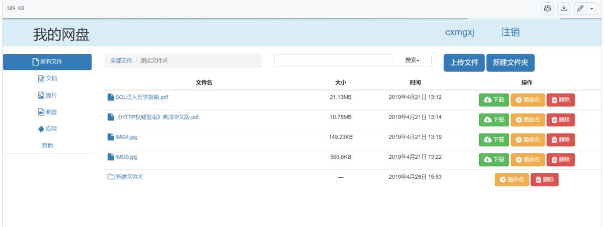

# A simple personal cloud storage based on Django framework

### Environment: Python 3.7, Django 2.1.7, MySQL 5.7, pymysql 0.9.3, Bootstrap 3.3.7, jQuery v3.3.1

## Project Preview:



## Basic Functions:

-

1. User registration, login, and user data are stored in MySQL, which is the Django's user_auth table.

-

2. Create a user directory named after the username, and create five subdirectories under the user's home directory to store files of different categories.

-

3. After logging in, users can view their own files, upload files, preview online, download, and delete them.

-

4. Page Functionality:

-

1. The right-side link bar serves as a category area, and the left-side file display area table is refreshed through AJAX.

-

2. The top of the table is a button for uploading, along with a search bar, which allows for category-based searches and dynamically refreshes the table content via AJAX.

## Update Function:

-

1. Refactor the file storage directory and data model for storing files

-

1. Upload progress bar

-

2. Add folder functionality, supports creation, modification, and deletion of folders.

-

3. Support folders, file renaming

-

4. Added some nice icons...

## How to Use:

### 1. Installing a virtual environment
cd cloud  
pipenv install --dev  
pipenv shell  
`

### 2. Configure database information in settings.py, set DEBUG=True during debugging, then establish the database model.

```
python manage.py makemigrations  
python manage.py migrate  

```

### 3. Starting the service

```
python manage.py runserver 127.0.0.1:8000  

```

### 4. Testing whether the testing service is started

Visit the browser at 127.0.0.1:8000, navigate to the login page, test registration, login, upload files, categorize files, search files, and delete files functionalities.


## Payment

Here is a pay link on Stripe ( https://buy.stripe.com/3cs8yP7sY87d0vu9AB ). Please contact me lonlonago@foxmail.com after funding $89, and I will send you a complete data files , thank you!


